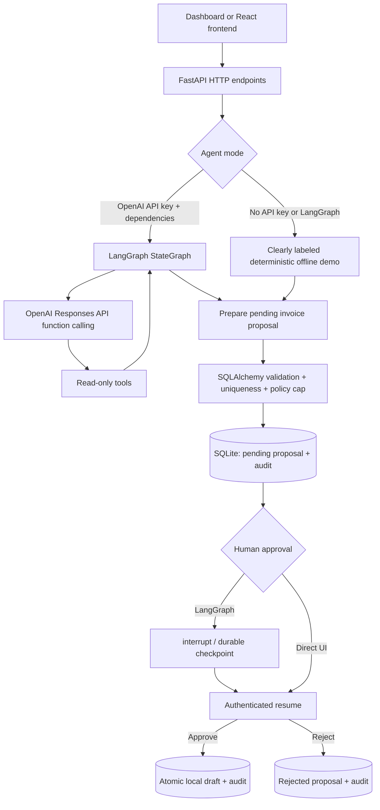

# Architecture: FinPilot MVP (v1)

## The trust boundary

- An LLM may choose **read-only** functions and request `prepare_invoice_draft` but can never invoke approval or create an invoice itself.
- Tool inputs are validated with Pydantic. The deterministic finance layer also checks customer existence, $50,000 maximum, reference uniqueness, and idempotency keys.
- Before human approval, the system persists **only a pending proposal**. Local `Invoice` rows are created in the authenticated approval transition.
- `APP_APPROVAL_TOKEN` is checked on the server before entering either approval path. This is **demo authorization only**.
- LangGraph checkpoints use a separate SQLite file and `thread_id`. `interrupt` resumes with a `Command`, and resumed nodes perform writes only **after** the interrupt, preserving side-effect safety.
- The offline demo is not an LLM and does not claim to perform arbitrary natural-language analysis.

## API routes

| Endpoint | Function |
|---|---|
| `GET /` | Dependency-free web dashboard |
| `GET /health` | Agent mode/configuration state |
| `GET /overview` | Derived dashboard metrics |
| `GET /customers` | Synthetic customer list |
| `GET /invoices` | Local created drafts |
| `GET /policy` | Read-only financial policy |
| `GET /requests` | Pending, approved, rejected proposals |
| `POST /requests` | Validate, store one pending request |
| `GET /requests/{id}` | Read proposal |
| `POST /requests/{id}/decision` | Local token-protected approve/reject |
| `GET /audit` | Server-side event records |
| `POST /agent/chat` | Offline demo or LangGraph tool agent |
| `GET /agent/threads/{thread_id}` | Read agent run / checkpoint state |
| `POST /agent/threads/{thread_id}/decision` | Protected approval of agent proposal |

## Reliability implementation and limitations

Existing: database transaction for approval, uniqueness constraint + case-insensitive unique index, source request uniqueness, idempotent approval retry, audit inserts, independent offline agent run persistence, basic LangGraph SQLite checkpointer source code, strict tool schemas, capped tool turns.

Not implemented or not verified: production distributed locking, PostgreSQL migrations, credentialed user/role management, OpenAI API live execution, end-to-end browser UI screenshot, compiled React build, true network fault injection / production load, monitoring, QuickBooks connectivity.
